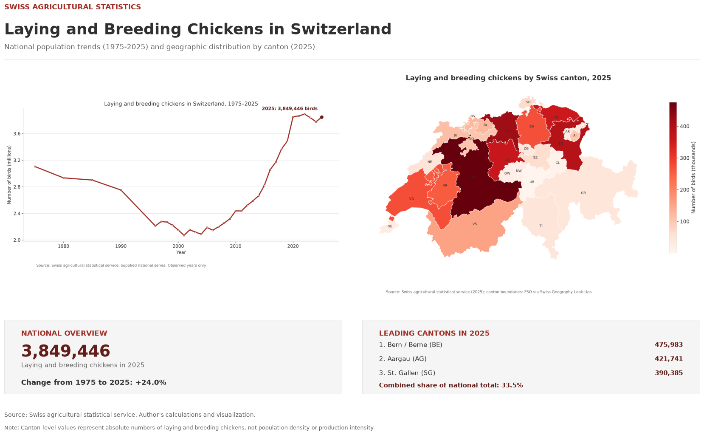
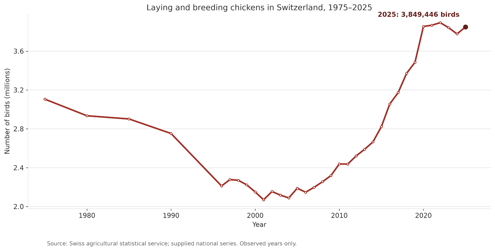
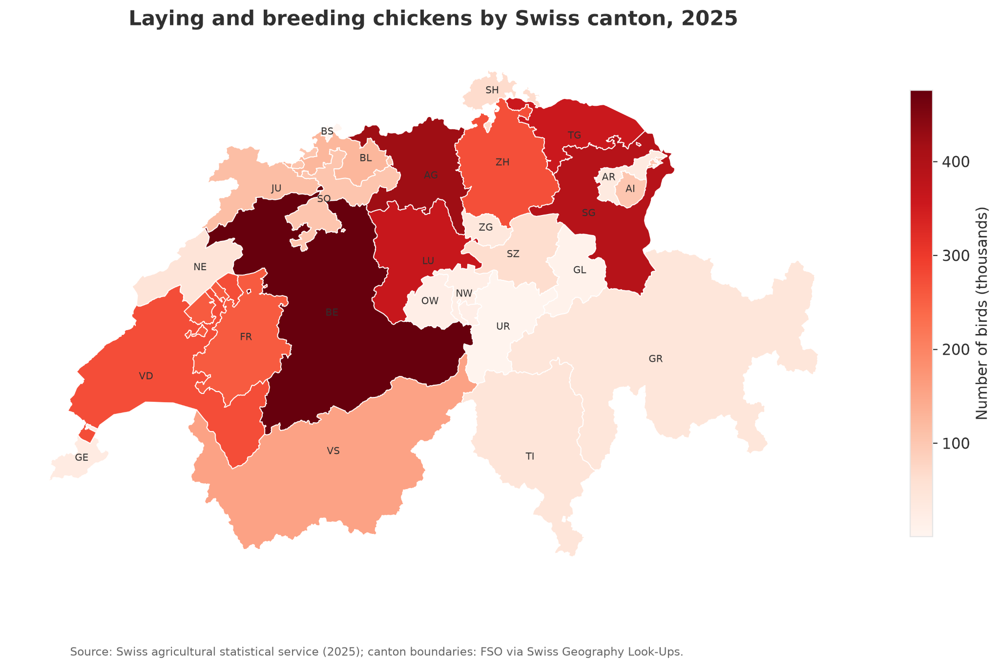

# Swiss Laying and Breeding Chickens | 1975–2025

A reproducible statistical visualization of the Swiss laying and breeding chicken population, combining a national historical series with a 2025 canton-level choropleth.

## Infographic

## Individual figures

**National trend (1975–2025)**

**Distribution by canton (2025)**

## Reproducibility

See [the commented Jupyter notebook](Swiss_Laying_and_Breeding_Chickens_Research.ipynb) for import, quality assurance, plotting, geography matching and infographic composition. Run Jupyter from this project's root folder (`python -m notebook` or open the folder in VS Code), install `pandas matplotlib geopandas requests`, and **Run All**. The choropleth needs internet access on its first run to retrieve public canton boundaries.

The notebook uses project-relative paths and stores figures in `outputs/`. Notebook execution outputs have been cleared before publication. The `data/` folder contains the two source CSVs required to reproduce the analysis.

## Key results

- National total (2025): **3,849,446** laying and breeding chickens.
- Change from 1975 to 2025: **+24.0%**.
- Highest 2025 counts: Bern, Aargau and St. Gallen.

## Sources and interpretation

Source: Swiss agricultural statistical service (supplied national and canton series). Geographic canton boundary polygons: Swiss Geography Look-Ups, based on Swiss Federal Statistical Office geometry; see link in notebook. Cantonal counts are absolute numbers, not a measure of density or intensity. Years in the national plot are observed years only.
